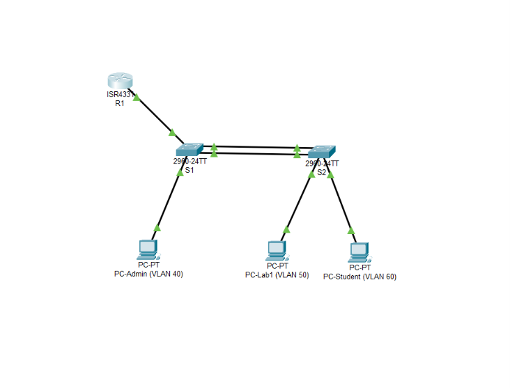
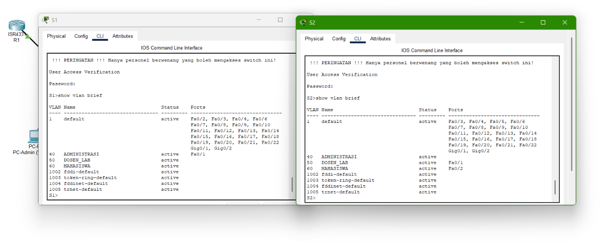
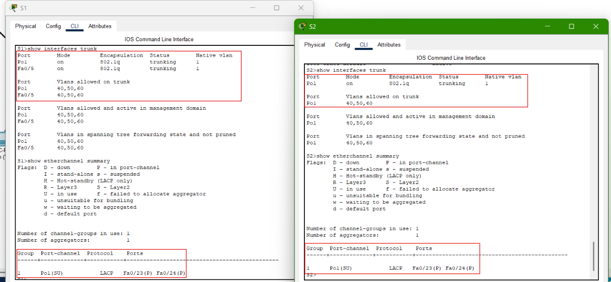
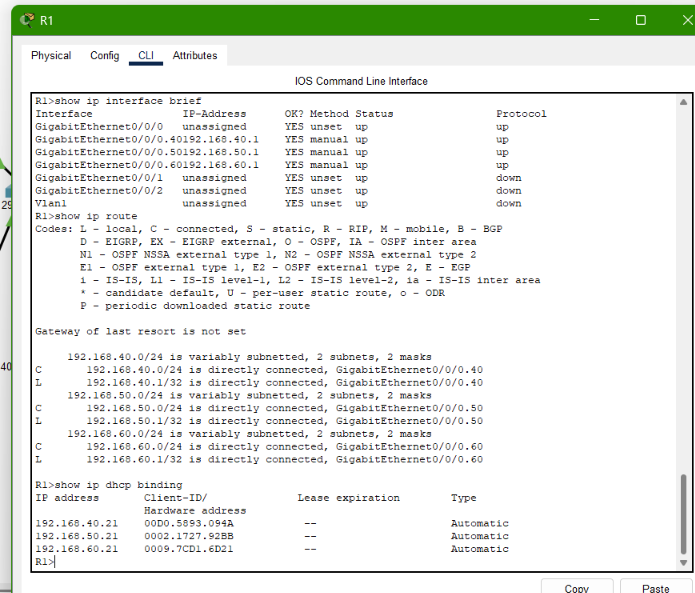
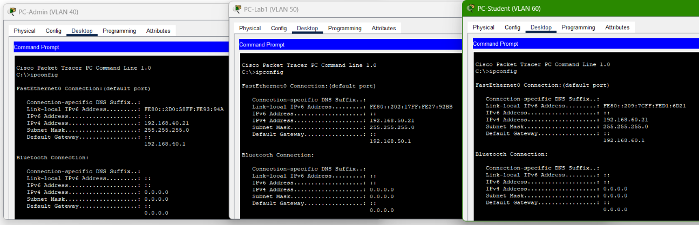
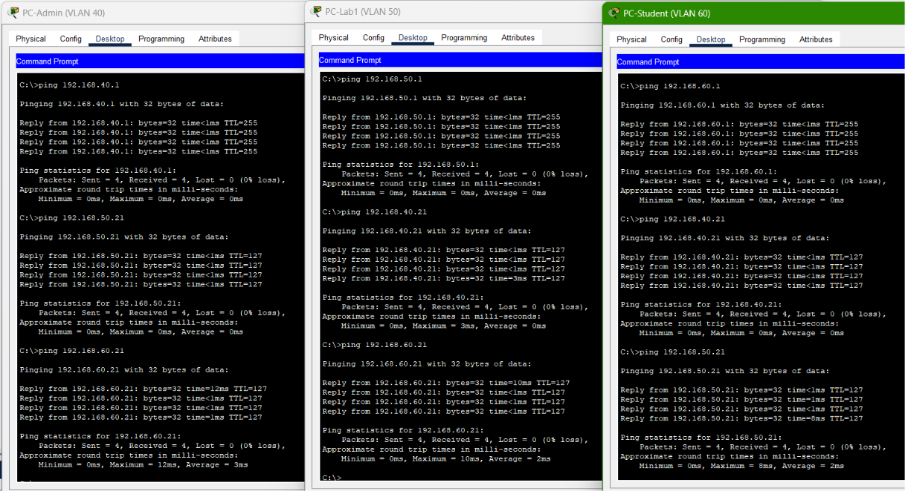

# Laporan Praktikum Manajemen Jaringan Komputer

## Konfigurasi Jaringan Antar Lantai dengan VLAN, Trunk Ethernet, EtherChannel, Router-on-a-Stick, dan DHCP

**Platform:** Cisco Packet Tracer  
**Perangkat utama:** R1, S1, S2, PC-Admin, PC-Lab1, dan PC-Student

## 1. Tujuan

Membangun simulasi jaringan dua lantai dengan tiga VLAN, menghubungkan switch menggunakan trunk dan EtherChannel, menyediakan routing antar-VLAN melalui router-on-a-stick, serta memberikan alamat IP secara otomatis menggunakan DHCP.

## 2. Topologi dan perangkat

Jaringan terdiri dari R1, S1 sebagai switch Lantai 1, S2 sebagai switch Lantai 2, serta tiga PC yang mewakili VLAN Administrasi, Dosen/Lab, dan Mahasiswa. R1 terhubung ke S1 melalui trunk pada Fa0/5. S1 dan S2 terhubung melalui dua link Ethernet Fa0/23 dan Fa0/24 yang digabungkan menjadi EtherChannel LACP (Po1).

_Gambar 1. Topologi jaringan antar lantai di Cisco Packet Tracer._

## 3. VLAN dan skema IP address

| VLAN ID | Nama         | Subnet            | Gateway        | Alamat PC                   |
| ------: | ------------ | ----------------- | -------------- | --------------------------- |
|      40 | Administrasi | `192.168.40.0/24` | `192.168.40.1` | PC-Admin: `192.168.40.21`   |
|      50 | Dosen/Lab    | `192.168.50.0/24` | `192.168.50.1` | PC-Lab1: `192.168.50.21`    |
|      60 | Mahasiswa    | `192.168.60.0/24` | `192.168.60.1` | PC-Student: `192.168.60.21` |

_Gambar 2. VLAN 40, 50, dan 60 serta penempatan port access pada switch._

VLAN dibuat pada S1 dan S2. Port Fa0/1 pada S1 digunakan oleh PC-Admin di VLAN 40, sedangkan Fa0/1 dan Fa0/2 pada S2 digunakan oleh PC-Lab1 di VLAN 50 dan PC-Student di VLAN 60.

## 4. Implementasi trunk dan EtherChannel

Fa0/5 pada S1 dikonfigurasi sebagai trunk menuju R1. Link S1–S2 menggunakan Fa0/23 dan Fa0/24 yang digabungkan menjadi EtherChannel Po1 dengan LACP. Po1 beroperasi sebagai trunk untuk membawa VLAN 40, 50, dan 60 antar-switch.

_Gambar 3. Output `show interfaces trunk` dan `show etherchannel summary` untuk memeriksa trunk serta status EtherChannel._

Hasil pemeriksaan menunjukkan Po1 aktif (`SU`) dan kedua port anggota ditandai `P`, yang berarti keduanya tergabung dalam EtherChannel.

## 5. Router-on-a-Stick dan DHCP

R1 menggunakan subinterface untuk menyediakan gateway setiap VLAN:

- VLAN 40: `192.168.40.1/24`
- VLAN 50: `192.168.50.1/24`
- VLAN 60: `192.168.60.1/24`

R1 juga memiliki DHCP pool untuk setiap subnet. Rentang alamat yang digunakan endpoint pada pengujian adalah `.21` pada masing-masing subnet.

_Gambar 4. Status interface R1, pool/binding DHCP, dan alamat yang diberikan kepada endpoint._

## 6. Hasil pengujian dan verifikasi

Pengujian dilakukan dengan memeriksa alamat IP pada setiap PC, melakukan ping ke gateway, dan menguji komunikasi antar-VLAN.

### 6.1 Alamat IP endpoint

_Gambar 5. Alamat IP, subnet mask, dan default gateway pada PC-Admin, PC-Lab1, dan PC-Student._

| Endpoint   | IP address      | Subnet mask     | Default gateway |
| ---------- | --------------- | --------------- | --------------- |
| PC-Admin   | `192.168.40.21` | `255.255.255.0` | `192.168.40.1`  |
| PC-Lab1    | `192.168.50.21` | `255.255.255.0` | `192.168.50.1`  |
| PC-Student | `192.168.60.21` | `255.255.255.0` | `192.168.60.1`  |

Ketiga PC memperoleh alamat dan gateway yang sesuai dengan VLAN masing-masing melalui DHCP.

### 6.2 Ping gateway dan antar-VLAN

_Gambar 6. Hasil ping dari PC ke gateway dan ke endpoint pada VLAN lain._

| Sumber     | Tujuan                     | Hasil              |
| ---------- | -------------------------- | ------------------ |
| PC-Admin   | Gateway `192.168.40.1`     | 4/4 reply, 0% loss |
| PC-Lab1    | Gateway `192.168.50.1`     | 4/4 reply, 0% loss |
| PC-Student | Gateway `192.168.60.1`     | 4/4 reply, 0% loss |
| PC-Admin   | PC-Lab1 `192.168.50.21`    | 4/4 reply, 0% loss |
| PC-Admin   | PC-Student `192.168.60.21` | 4/4 reply, 0% loss |
| PC-Lab1    | PC-Admin `192.168.40.21`   | 4/4 reply, 0% loss |
| PC-Lab1    | PC-Student `192.168.60.21` | 4/4 reply, 0% loss |
| PC-Student | PC-Admin `192.168.40.21`   | 4/4 reply, 0% loss |
| PC-Student | PC-Lab1 `192.168.50.21`    | 4/4 reply, 0% loss |

Seluruh enam pengujian ping antar-VLAN berhasil dengan empat paket diterima dari empat paket terkirim (`0% packet loss`). Ping gateway pada ketiga PC juga berhasil.

## 7. Ringkasan hasil

| Komponen            | Hasil pemeriksaan                               | Status |
| ------------------- | ----------------------------------------------- | ------ |
| VLAN 40, 50, dan 60 | Aktif pada S1 dan S2                            | Lulus  |
| Port access         | PC ditempatkan pada VLAN sesuai perancangan     | Lulus  |
| Trunk S1 ke R1      | Trunking dan membawa VLAN yang diperlukan       | Lulus  |
| EtherChannel S1–S2  | Po1 aktif; Fa0/23 dan Fa0/24 tergabung          | Lulus  |
| Router-on-a-Stick   | Subinterface gateway VLAN aktif                 | Lulus  |
| DHCP                | Ketiga PC memperoleh IP dan gateway yang sesuai | Lulus  |
| Ping ke gateway     | Ketiga PC berhasil                              | Lulus  |
| Ping antar-VLAN     | Keenam pengujian berhasil, 0% packet loss       | Lulus  |

## 8. Kesimpulan

Simulasi jaringan antar-lantai berhasil dikonfigurasi menggunakan VLAN 40, 50, dan 60. Trunk Ethernet dan EtherChannel LACP menghubungkan switch, sementara router-on-a-stick menyediakan routing antar-VLAN. DHCP pada R1 memberikan alamat IP yang sesuai kepada ketiga PC. Hasil pengujian menunjukkan seluruh ping ke gateway dan antar-VLAN berhasil tanpa packet loss.

Proyek ini mendemonstrasikan segmentasi jaringan dengan VLAN, koneksi trunk, EtherChannel berbasis LACP, DHCP, dan komunikasi antar-VLAN menggunakan Cisco Packet Tracer.
