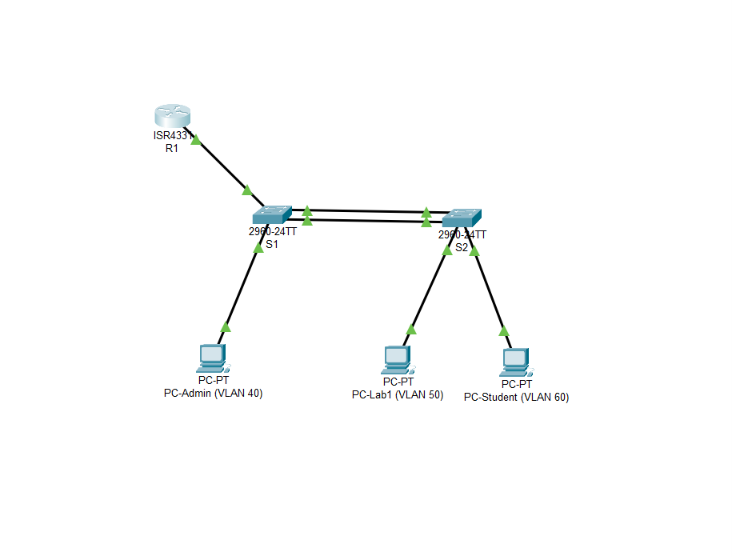

# Inter-Floor Network Configuration — Cisco Packet Tracer

Simulasi jaringan dua lantai untuk praktikum Manajemen Jaringan Komputer. Proyek ini menerapkan segmentasi VLAN, trunk Ethernet, EtherChannel LACP, router-on-a-stick, DHCP, dan pengujian konektivitas antar-VLAN.

## Topologi

_Topologi terdiri dari R1, S1 (Lantai 1), S2 (Lantai 2), PC-Admin, PC-Lab1, dan PC-Student._

## Teknologi dan konfigurasi

- **VLAN 40 — Administrasi:** `192.168.40.0/24`, gateway `192.168.40.1`
- **VLAN 50 — Dosen/Lab:** `192.168.50.0/24`, gateway `192.168.50.1`
- **VLAN 60 — Mahasiswa:** `192.168.60.0/24`, gateway `192.168.60.1`
- **Trunk:** S1 Fa0/5 ke R1 dan Port-Channel 1 (Po1) antara S1–S2.
- **EtherChannel:** LACP menggunakan S1/S2 Fa0/23 dan Fa0/24.
- **Router-on-a-Stick:** subinterface R1 menjadi gateway untuk ketiga VLAN.
- **DHCP:** R1 memberikan konfigurasi IPv4 kepada ketiga PC.

## Hasil pengujian

- Ketiga VLAN aktif dan port PC ditempatkan pada VLAN yang sesuai.
- Trunk membawa VLAN 40, 50, dan 60.
- EtherChannel Po1 aktif (`SU`) dan kedua link anggota tergabung (`P`).
- Ketiga PC memperoleh IP address dan default gateway yang sesuai.
- Ping gateway berhasil dari seluruh PC.
- Keenam pengujian ping antar-VLAN berhasil dengan `4/4` reply dan `0% packet loss`.

## Dokumentasi dan file proyek

- [Laporan praktikumh](Laporan_Praktikum_Manajemen_Jaringan.md)
- [File Cisco Packet Tracer](Inter-Floor%20Network%20Configuration%20-%20Cisco%20Packet%20Tracer.pkt)
- Folder [`evidence/`](evidence/) berisi screenshot topologi, VLAN, trunk/EtherChannel, DHCP, alamat PC, dan hasil ping.
